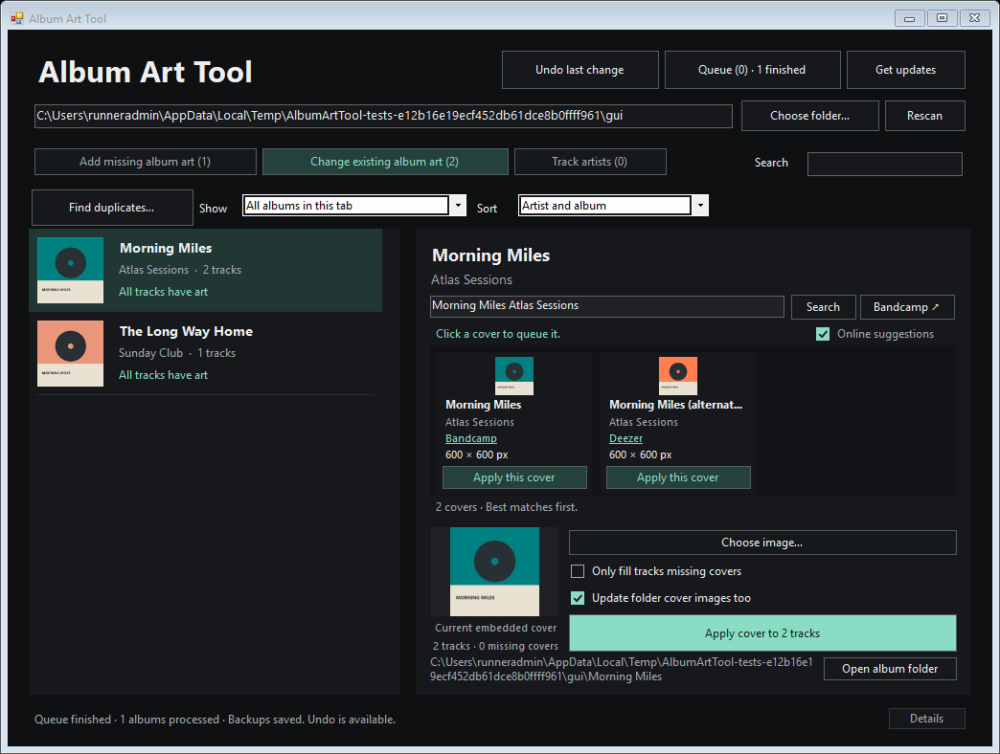
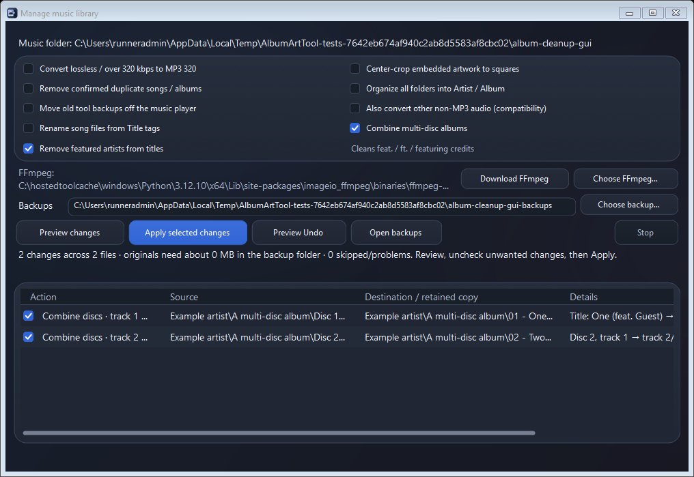

# Music Library Manager (Album Art Tool)

One Windows app for album artwork, artist cleanup, MP3 conversion, duplicate removal, square embedded covers, and recursive music organization.

**[Download the Windows installer](https://github.com/ISASTO/Album-Art-Tool/releases/latest)** · `AlbumArtTool-Setup.exe` · Windows 10/11, 64-bit.



*Interface shown with test albums and example search results.*

[Light mode preview](docs/light-mode.png)

The app starts in **dark mode**. Click **Light mode** in the header to switch, or **Dark mode** to switch back. Your choice is remembered on this PC and updates open tool windows without interrupting work or discarding a staged cover.

Switching themes is instant: every color is a theme resource, so the whole interface changes in one repaint, with a short gradient wipe (skipped when Windows reduced-motion is on). Open tool windows and staged covers are kept.

The interface is GPU-rendered (Avalonia) and the app is compiled ahead of time to native code, so it starts quickly and stays responsive with large libraries: the album list is virtualized, thumbnails are decoded only for visible rows, and folders are scanned in parallel. Windows 11 adds native window corners and matching title-bar colors.

## Use it

1. Download and run **AlbumArtTool-Setup.exe** from Releases. It installs for your Windows account only (no administrator prompt) with a Start menu entry and an uninstaller in **Settings → Apps**. Prefer no installer? `AlbumArtTool-Portable.zip` contains the same app: unzip it anywhere and it opens the folder it is in, like earlier versions.
2. Open **Music Library Manager** and use **Choose folder** to pick the top folder of your music collection. The app scans that folder and every subfolder, and reopens it next time.
3. **Add missing album art** shows albums where one or more tracks lack an embedded front cover. **Change existing album art** shows albums with embedded or folder artwork. Both artwork tabs open on **All albums in this tab**, without inheriting the track-artist cleanup filter.
4. Select an album. Online suggestions automatically search its **album title + artist name** and display cover choices inside the app.
5. **Click a cover or its Apply this cover button to add it to the work queue.** Continue selecting other albums while covers download and save in the background. Backups and Undo work for online changes too.

You can still drag a JPG, PNG, BMP or GIF from File Explorer onto an album row or the small cover preview, or use **Choose image**. Local images are staged first; click the larger **Apply cover** button to apply them.

If an album already has a folder cover, **Apply cover to X tracks** is enabled immediately. It uses the full-size image behind the preview, so you do not need to choose that file again. The same shortcut can copy the displayed embedded cover to tracks that are missing it.

The **Queue** button shows active and waiting albums, recent results, and **Clear waiting jobs**. Albums in the list are marked **Queued** or **Applying cover…**. Jobs run one at a time; each keeps the album, image, and checkbox settings you chose when adding it. A failed job does not block later albums. You can browse both tabs, search, stage images and queue more work throughout. Folder switching, rescanning and Undo are available when the queue finishes. To close with work pending, clear waiting jobs and let the current update finish.

No accounts, API keys or background service. Online suggestions use the internet; uncheck **Online suggestions** to work offline. The app is self-contained: no .NET runtime or other prerequisite needs to be installed.

Scanning first counts supported music files using directory listings, without reading audio tags. It then shows a filling progress bar, a percentage, and an exact counter such as **2751/3867 tracks scanned**. Files that fail to open still count as checked and appear in Details. The initial counting phase can also be stopped. Disabled options keep readable text in both themes.

Folders are read several at a time. Unchanged folders reuse their scanned tags and artwork, and that cache is saved on this PC, so reopening the app on an unchanged library does not reopen every music file. File listings, sizes and modification times are checked each time; new, deleted or modified tracks and folder covers trigger a fresh folder scan. **Shift-click Rescan** (or Shift+F5) to force every file to be read again. Identical embedded covers are validated once per scan rather than decoded once for every track. Backups calculate source checksums while copying, then still verify the saved backup and recheck the source before replacement. The biggest repeat-scan benefit is avoiding audio-file opens; first-scan and write speeds still depend on the source and backup drives.

[Scan progress preview](docs/scanning.png) · [Background queue preview](docs/queue.png)

## Manage the whole library

Click **Manage library** in the main window. Choose any combination of:

- **Convert lossless / over 320 kbps to MP3 320.** Lossless sources and audio reporting more than 320 kbps are eligible. Existing MP3s at 320 kbps or below and lower-bitrate lossy sources are left alone. Bitrate is a practical rule, not a way to measure perceptual quality across codecs. If compatibility matters more than avoiding another lossy encode, explicitly check **Also convert other non-MP3 audio**. That option does not improve the quality of a low-bitrate source. Containers with a video track are skipped by automatic audio conversion and packet-hash-only duplicate removal. Conversion retains standard tags and embedded images, verifies the output's bitrate and duration, and decodes the complete new MP3 before replacing its source. Originals stay in the PC backup folder.
- **Remove confirmed duplicate songs / albums.** Only verified matching file/audio contents within the same logical album and titled track are eligible. Conflicting known disc/track numbers are preserved. Copies on different albums, copies across folders without enough artist/album metadata, possible metadata-only matches, and distinct recordings are kept. A copy with embedded artwork is preferred; suffixes such as `(1)` or `copy` are disfavored. The preview names the retained copy. Removed copies go to verified PC backups, outside the active music tree. With FFmpeg available, matching demuxed audio packets can also verify retagged copies in other containers.
- **Center-crop embedded artwork to squares.** Every nonsquare embedded image is cropped from its center at its native resolution. A 1800 × 1000 image becomes 1000 × 1000; it is not stretched or scaled down to a thumbnail. Already-square pictures keep their original image bytes. JPEG input stays JPEG; other input is saved as PNG. Cropping applies to all embedded pictures, including back covers; image order, types where supported by the format, and descriptions remain. Folder images are moved with albums but are not cropped by this option.
- **Organize all folders into Artist / Album.** The app searches every level and builds a canonical path under the selected music root from embedded album-artist/artist and album tags. It does not trust or reproduce intermediate artist, year, downloads, or redundant folders. Existing filenames are preserved unless **Rename song files from Title tags** is selected, apart from a changed `.mp3` extension after conversion and conflict suffixes when necessary. Disc subfolders are retained for identified multidisc releases. Tagged Various Artists albums stay together. Missing usable artist/album tags leave that track in place with an explanation. Empty old directories are removed after successful changes.
- **Rename song files from Title tags.** This optional setting uses the embedded song Title as the filename: `01 - World Eater.mp3` becomes `World Eater.mp3` when the Title tag is `World Eater`. It searches every subfolder and works on its own or alongside conversion, cropping and folder organization. The existing audio extension is kept unless conversion changes it to `.mp3`. Filename-only cleanup leaves all audio, artwork and metadata bytes intact. Missing, blank or unusable Title tags keep the existing filename with an explanation; the app does not guess a title from the old filename. Characters Windows cannot use in filenames are replaced, reserved device names are prefixed with `_`, and long title components are limited to 120 characters. Conflicting names preserve both files with suffixes such as ` (2)`. Capitalization changes are supported. Review the Source and Destination columns, uncheck unwanted renames, then apply. **Preview Undo** restores the original filenames after a restart too.
- **Combine multi-disc albums.** Opt in to detect matching Disc/CD/Disk folders, numbered disc suffixes in album names, and disc tags inside a single folder. It supports any number of discs and orders them numerically. The preview combines available songs into one album folder, renumbers tracks consecutively from 1, sets the total track count, and resets disc tags to 1 of 1. Filenames are not changed by combining: songs keep their names (a clash between discs gets a numbered suffix such as ` (2)`). Select **Rename song files from Title tags** if you also want title-based names. Album-name disc suffixes are removed and album-artist grouping is made consistent; track artist credits stay intact. Select or clear a merge as a complete album in the preview. Matching is scoped to the album's source location so unrelated copies or releases are not combined solely because their names match. Ambiguous duplicate track numbers are reported for review. Artwork/booklets follow recognized albums, filename conflicts preserve both files, and persistent Undo restores the original files, tags and folder layout.
- **Remove featured artists from titles.** Opt in to remove conventional `feat.`, `ft.`, and `featuring` credits, including capitalization and punctuation variants, parentheses, square/curly/full-width brackets, and trailing inline credits. Both the Title tag and filename are cleaned. Version labels such as `(Live)`, `(Remix)` and `(2014 Remaster)` remain. Artist tags are not changed by this option. Missing Title tags are left missing; a filename can be cleaned independently. Preview shows the old and new titles, avoids empty titles, resolves filename conflicts without overwriting, and keeps exact originals for Undo. It works on its own or together with disc merging and other library operations.
- **Standardize embedded artwork.** Opt in to give every song exactly one embedded picture, in the front-cover (ID3 type 3) slot. When a song has several, the best cover is kept (a front cover first, then an unlabeled picture, then the largest image) and back covers, booklet pages and duplicates are removed. Pictures larger than 600 × 600, non-JPEG pictures, and JPEGs saved above quality 88 become JPEGs of at most 600 px at quality 88; smaller pictures are never enlarged. Pictures already in that form are left byte for byte. Leftover tag padding is removed, so the files really get smaller. With square cropping also selected, artwork is cropped at full resolution first, then resized. Audio and other tags are unchanged; Undo restores the originals exactly.
- **Fill missing Title tags from filenames.** Opt in to give songs without a Title tag their filename as the title, minus the extension and any leading track number ("01 - Song.mp3" → "Song"). Songs that already have a title are left alone, and the file keeps its name. The Check library window has a **Fill titles from filenames…** button that opens this preview directly. Undo restores the originals exactly.
- **Standardize MP3 tags to ID3v2.3 (UTF-16).** Opt in to rewrite MP3 tags (and ID3 tags in AIFF/WAV files) as ID3v2.3 with UTF-16 text, the version every player reads. Tag contents are unchanged; ID3v2.4 dates are written as their v2.3 equivalents (TYER, TDAT, TIME, TORY), and an MP3 with only an ID3v1/APE tag gets an ID3v2.3 tag with the same fields. Files already in that form are left alone.
- **Move old tool backups off the music player.** Old `.album-art-backups`, `.before-square-crop`, and `.covercrop-tmp-` backup files can be archived to the PC. Some players index hidden backup folders as more music, which can create apparent duplicates even when the active album itself is correct. This option is included in the preview and can be unchecked.



Set **Backups** to a folder on your PC, outside the selected music folder. The default is `%LOCALAPPDATA%\AlbumArtTool\LibraryBackups`. The preview estimates backup space; original-changing operations require that space before starting. Choose the top music folder rather than a whole PC drive if the backup folder would otherwise be inside the source tree.

Click **Preview changes**. Nothing is moved, replaced, cropped or removed during the preview. Review the source/destination paths and uncheck unwanted actions. Then click **Apply selected changes**. You can stop the run; already completed work remains recorded and originals are protected. The rest of the app remains responsive, while conflicting artwork/artist writes and rescans wait for the bulk task to finish. A full scan refreshes the library afterward. During scanning and applying, the options panel stays stable and the preview remains readable and scrollable. Operation checkboxes are locked while work is running.

For example, both `Music/Artist/Artist/Album/song.flac` and `Music/Artist/2020/Album/song.flac` resolve to `Music/Artist/Album/song.mp3` when their tags identify the same artist/album and conversion is selected. Loose tagged tracks in `Music/Downloads/Unsorted/` are organized under that same top-level `Music/Artist/Album/` structure. This differs deliberately from the old Python script's per-collection output: the selected music root is now the single destination root.

Recognizable album folders keep artwork, booklets, cue sheets, lyrics and common sidecar files with their album. Ambiguous assets beside mixed loose collections stay in place. Playlist and cue-sheet references are preserved as written, not rewritten for changed filenames; review them after renames, conversion or moves. Conflicting filenames preserve both files using a numbered suffix; existing files are never silently overwritten. Unsupported files, unreadable directories, invalid artwork, stale previews and write failures are reported or skipped while their originals remain available.

**Undo:** click **Preview Undo**, review/check the saved changes, then **Undo selected changes**. The last bulk run can be undone after an app restart. Undo uses a persistent journal and refuses to overwrite files edited afterward. **Open backups** opens the backup location. Each bulk run includes `journal.json`, an incremental operation log while running, original files when needed, and a readable `report.csv`. Simple moves keep location/history hashes rather than duplicating every song into the backup folder.

### FFmpeg setup

Cropping, organization, artist edits and MP3/FLAC duplicate verification do not need an encoder. Conversion uses the separate **FFmpeg** command-line tool. **Download FFmpeg** installs a verified Windows static LGPL build from [BtbN/FFmpeg-Builds](https://github.com/BtbN/FFmpeg-Builds) into the app's PC cache, including upstream license notices and download-source information. The one-time ZIP download is currently roughly 170 MB. The app checks GitHub's SHA-256 digest before extracting or launching it. Automatic setup requires 64-bit Windows.

You can instead click **Choose FFmpeg** to select an existing `ffmpeg.exe`, or put it beside the app/on PATH. The chosen location is remembered. No Python, PowerShell scripts, ffprobe, account or separate installer is required. An internet connection is only needed for setup, artwork lookup or app updates; once FFmpeg is present, all library processing works locally. The app does not send music files to the internet. High sample rates and multichannel inputs are adapted to MP3's supported output; the original higher-quality file remains backed up.

## Track artist cleanup

Open **Track artists** to find albums whose track credits can be collapsed to the main artist. This tab includes albums with and without cover art. **Show → Artist cleanup available** lists albums with suggested changes; **Show → All albums in this tab** lets you review any album and enter an artist manually. **Sort → Artist changes first** puts albums with the most changes at the top. Artist/album and album-title sorting are also available.

Select an album, compare **Current artist** with **After cleanup**, and edit **Main artist** if necessary. Already-correct tracks say **Unchanged**. Only actual track-artist differences count toward the cleanup filter and button; missing or different Album artist tags, capitalization and whitespace alone do not make a track eligible. Click **Set artists on X tracks** to queue the change, then continue with another album. For your BENEE example, tracks credited to BENEE and guests become a single **BENEE** credit. On the tracks that need cleanup, **Artist** is set to the entered name; existing **Album artist** and artist sort fields are updated too. Missing Album artist tags remain missing so partial cleanup does not split an album into separately tagged groups. Already-correct tracks are left byte-for-byte unchanged. Track titles, artwork, audio and other tags stay as they are.

The suggestion uses a specific tagged album artist first, or a consistent lead artist across the tracks when album artist is missing or says Various Artists. A consistent band name such as **Earth, Wind & Fire** stays intact. Mixed-artist compilations without a consistent lead get no automatic suggestion; you can review them with the all-albums filter. Review inferred names before queueing.

Artist jobs share the artwork queue, freeze the selected album/name at enqueue time, and use the same full-file backups, stale-file protection and **Undo last change**. Already-correct tracks are skipped. Failed writes are listed in Details. Artist cleanup does not rename or move files/folders. The cleanup filter removes an album once its artist fields match.

Use **Open album folder** below the artist preview to open the selected album in File Explorer. Select a track row and click **Show selected track** to open its folder with that song highlighted. Large album lists are virtualized.

[Track artist cleanup preview](docs/track-artists.png)

## Check library

Click **Check library…** after a scan to list:

- **Songs missing a Title tag.** Players show these by filename. Blank titles count as missing.
- **Songs with more than one embedded picture**, with a description such as *2 front covers, 1 back cover*. Songs with several front or unlabeled covers come first, because players may show any of them.
- **Lossy songs below a bitrate you choose** (96–320 kbps, 192 by default), lowest first, with their format — handy for finding songs to download again in better quality. Lossless files (FLAC, ALAC, WAV, AIFF…) are never listed.

The check uses the last library scan, so it opens instantly and never changes a file. Select a song and click **Show selected file** to highlight it in File Explorer, or **Save report…** for a CSV. Rescan and click **Check again** after fixing files. **Fill titles from filenames…** and **Fix embedded pictures…** open Manage library with just the matching option selected and preview the fix.

## Find duplicate songs and albums

After scanning a music folder, click **Find duplicates**. A separate window scans the successfully read tracks in that folder tree, with a progress bar, percentage, checked/total counter and Stop button. Album browsing remains available. **Open selected folder** takes you to a result's location, and **Save report** exports a CSV with paths and the evidence for each match. Rescan the main library to include newly added music, then click Scan again in the duplicate window.

- **Confirmed song copies** have identical SHA-256 hashes of the entire file, or identical encoded MP3/FLAC audio data. MP3 tag blocks and FLAC metadata/artwork blocks are excluded from the audio comparison. Hover over a match to see which test confirmed it.
- **Confirmed album copies** have the same complete set of verified song contents in different folders. A folder containing only part of an album is not labeled a complete copy. Repeated tracks count separately when comparing album contents.
- **Possible song copies** match a tagged title, track artist and duration within two seconds. This can find different encodings and bitrates, but it can also include different recordings. **Possible album copies** match album/artist, track count, song titles, artists and durations. These require review.

The scanner only reads music. It does **not** delete, move or select copies for removal. Repeated music on a compilation can be an intentional duplicate. Other codecs get whole-file verification and metadata comparisons; they do not get a claim of identical audio across retagging or re-encoding. MP3 and FLAC audio checks compare encoded data, not perceptual fingerprints, so a re-encode can appear only as a possible match. Missing, linked or changed files are skipped with an explanation. Backups and temporary editor files remain excluded.

The first pass uses small audio samples and file sizes to find candidates; full hashes are then calculated for candidate files, rather than reading every complete song by default. Each run uses a snapshot of the main library scan. If you change tags or covers while it is working, changed files are skipped; rescan the library and click Scan again to get current results. App installation waits for an active duplicate scan before restarting.

[Duplicate scanner preview](docs/duplicates.png)

## App updates

Click **Get updates** in the header. The app checks this repository's latest published stable release, downloads the newer installer with progress, verifies GitHub's SHA-256 checksum and the installer's product name and version, then closes and runs it. The installer waits for the app to exit, replaces the installed files (rolling back if anything fails) and reopens the app in the same music folder. If you are already current, it reports your installed version. Checks only happen when you click the button; there is no background update service or account requirement.

You can keep working during the download. Installation waits for scans, library management/encoder setup, Undo, and every queued artwork job to finish. If you have a staged cover, apply it or press Esc to discard it before the update can restart. The update window has a Cancel button until installation starts. As with any restart, the in-memory artwork/artist queue history and its Undo session end; the bulk library journal and original backups remain available for Preview Undo.

**Upgrading from v2.x (portable EXE):** click **Get updates** in the old version as usual. It downloads an `AlbumArtTool.exe` bridge, which installs the new version and reopens your music folder. Afterwards, the old portable EXE simply opens the installed app, so existing shortcuts keep working. Settings, the backup folder, FFmpeg setup and the last library Undo journal carry over. No music files are sent to GitHub.

[Update window preview](docs/updates.png)

## Online cover search

- Only the selected album is searched. The query starts as `album title + artist name`; you can edit it and press Enter or Search if tags are incomplete or an edition needs clarification.
- Sources are searched independently, so one failing source cannot prevent the others from returning covers. Good title-and-artist matches rank first; **Bandcamp is preferred among similarly strong matches**, followed by high-resolution Deezer album artwork and front covers from MusicBrainz's Cover Art Archive.
- Bandcamp results depend on its public search page. If Bandcamp requires browser verification or blocks the request, the app reports that source as unavailable and stops retrying it for the session. The **Bandcamp ↗** button opens the same search in your browser. No CAPTCHA bypass, login or hidden API credentials are used.
- Cover Art Archive requests previews up to 250 pixels and front covers up to 1200 pixels; actual dimensions depend on the available image. Deezer uses its `cover_xl` image. Bandcamp uses the original cover asset when its public search results are available. The existing 1600-pixel embedded-art limit still applies.
- Each suggested cover shows the source image's resolution, such as **1000 × 1000 px**. Thumbnails appear first while the app checks the full-size image header. These checks read at most 128 KB per cover, with two running at a time. If a source cannot provide readable dimensions, the card says **Size unavailable**; the cover can still be selected.
- Source names beneath covers link to their album pages. Compare the title, artist and artwork before clicking, especially for similar titles or alternate releases.
- Results are cached for up to 24 queries during the current session. Rapid selection changes cancel stale searches. MusicBrainz requests are spaced at least 1.1 seconds apart; server rate-limit responses are respected.
- Searches send the displayed query to the sources, then download image previews and the chosen cover. Audio files and full local folder paths are never uploaded. Turning off automatic suggestions cancels the search; the Search button can still run an explicit one-time lookup.
- Offline connections, missing covers and failed downloads are shown inside the app. A failed download cannot change any music file. Local drag-and-drop remains available.

## What gets changed

- Artwork-only and artist-only edits do not re-encode audio. Optional MP3 conversion in Manage library does re-encode audio. Artwork is embedded into the audio files. Existing music metadata is preserved. Each song keeps exactly one embedded picture: the new front cover replaces every existing picture (back covers, booklet pages and disc pictures included).
- On the missing-art tab, **Only fill tracks missing covers** starts checked. Tracks that already have an embedded cover are left alone. Uncheck it to give the whole album the same cover.
- On the existing-art tab, the default is to replace the cover on every track in the selected album.
- **Update folder cover images too** updates recognized `cover`, `folder`, `front`, `album` and `albumart` images in that album's folder, preserving their file format. If there are none, it creates `cover.jpg`. This option is disabled when multiple albums share the folder. Unrelated images are untouched.
- A folder image alone does not mean the tracks have embedded covers. Those albums appear in the missing-art tab too, with a **Folder art only** label.
- New embedded covers are quality-88 JPEGs of at most 600 × 600, with their aspect ratio preserved. Images are never cropped or enlarged; transparency is flattened onto white. A saved cover.jpg keeps up to 1600 pixels. Inputs are limited to 30 MB and 40 million pixels.
- The existing-art preview shows the first readable embedded front cover, falling back to folder art. It does not imply that every track has the same cover.

## Albums and formats

Albums are grouped by **folder + album title + album artist**. Missing album tags fall back to the folder name. Track artist is not used as a grouping key, so compilations stay together. Separate folders and separate disc folders remain separate entries; this prevents one edition from changing another. Search also matches full folder paths.

Supported extensions: MP3, FLAC, M4A, M4B, OGG/OGA, Opus, WMA, WAV, AIF/AIFF, APE and WV. Files must have writable metadata supported by TagLibSharp. Unsupported or damaged files appear in **Details**, not as successfully processed tracks. The test suite exercises real MP3, FLAC, M4A, Ogg, Opus, WMA, WAV, AIFF and WavPack files.

Scans run in the background and can be stopped. Stopping keeps fully scanned folders; a partly scanned folder is excluded so it cannot be mistaken for a complete album. Directory junctions, symbolic links, system subfolders, backups and temporary copies are skipped. The app does not follow a link out of the selected music tree.

## Backups and Undo

Artwork/artist changes use temporary copies, verify the changed metadata, save and verify a full original in the PC backup folder, then replace the original safely. Backups can be on a different drive from the music player. New backups are no longer stored as playable files underneath each album. The default backup folder is `%LOCALAPPDATA%\AlbumArtTool\LibraryBackups`; **Manage library** shows the configured location. Bulk management also verifies original backups before removing or replacing source files.

**Undo last change** restores the most recent completed artwork/artist edit in the current session once the queue is idle. **Preview Undo** in Manage library restores the last bulk run, including moves, removals, conversions and crops, and survives an app restart. Full originals remain in the PC backup folders for manual recovery. Backups use disk space; keep them until you have reviewed the results. Old album-local backups can be moved to the PC using the dedicated bulk option. A bulk run clears the artwork/artist Undo shortcut because those paths may have moved; the bulk journal records that run separately.

Files changed since the scan, read-only files, and files locked against replacement are skipped with an explanation. Undo also refuses to overwrite a file edited by another program after this app's change. Changes are independent per file: if one track fails, successfully updated tracks stay updated and the remaining errors are listed in **Details**. Filesystems must support atomic file replacement; if they do not, the affected file is left unchanged.

## Keyboard

- **Ctrl+F**: search
- **F5**: rescan
- **Ctrl+Z**: undo last change
- **Esc**: discard the staged cover
- Arrow keys: select an album

## Build and test

Install the .NET 10 SDK. The core library and the full test suite (including headless checks of every window) also build and run on Linux and macOS.

```powershell
# Run from source
dotnet run --project src/AlbumArtTool

# Native Windows build (ahead-of-time compiled)
dotnet publish src/AlbumArtTool/AlbumArtTool.csproj -c Release -r win-x64 -o dist/app

# Installer (Inno Setup 6)
ISCC.exe /DAppVersion=3.0.0 /DSourceDir=dist\app /DOutputDir=dist installer\AlbumArtTool.iss
```

To run the integration suite, install FFmpeg and point `ALBUMART_FFMPEG` at its executable. Screenshots of each window are saved to the folder you pass:

```powershell
dotnet build tests/AlbumArtTool.Tests/AlbumArtTool.Tests.csproj -c Release
$env:ALBUMART_FFMPEG = 'C:\path\to\ffmpeg.exe'
dotnet tests/AlbumArtTool.Tests/bin/Release/net10.0/AlbumArtTool.Tests.dll TestResults
```

Options: `--benchmark` times cold, cached and post-restart scans of a synthetic 720-track library; `--live-search`, `--live-update` and `--live-encoder` exercise the real online services. The tests use a private data folder (`ALBUMART_DATA`), never your real settings or backups.

The suite covers real round trips in nine audio formats (decoded-audio hashes, preserved metadata, single front covers, byte-exact Undo), scanning (parallel progress, cancellation, corrupt files, stale scans, read-only files, folder art, the saved scan cache), artist cleanup, duplicate detection, every library-management operation together with persistent Undo and crash recovery, journals written by v2.x, online source parsing and safety checks, and update verification. Headless GUI checks drive the main window, queue, track-artist tab, duplicate window, library manager, theme switching and the update handoff. CI also installs and uninstalls the real installer, measures startup next to v2.5.2, and upgrades a real v2.5.2 portable copy through its own built-in updater. Test audio fixtures are short synthesized tones generated by `tests/AlbumArtTool.Tests/generate_fixtures.py`; they contain no copyrighted music.

Push a `v*` tag, or include `[release]` in a commit message on `main`, to build, test and publish a release (installer, v2.x update bridge, portable ZIP and checksums). The version comes from `Directory.Build.props`. A release is published only after the Windows and Linux checks pass; existing releases are never replaced automatically.

## License

The GUI app is MIT licensed. FFmpeg is a separate optional program with its own licenses; automatic setup retains its upstream notices and source URL in the encoder cache. TagLibSharp is LGPL-2.1-or-later and Avalonia/SkiaSharp are MIT; see `THIRD-PARTY-NOTICES.txt` and `licenses/`. The native build links TagLibSharp into the app, so the complete source and build instructions above are provided to let you rebuild the app with a modified TagLibSharp, as the LGPL permits.
