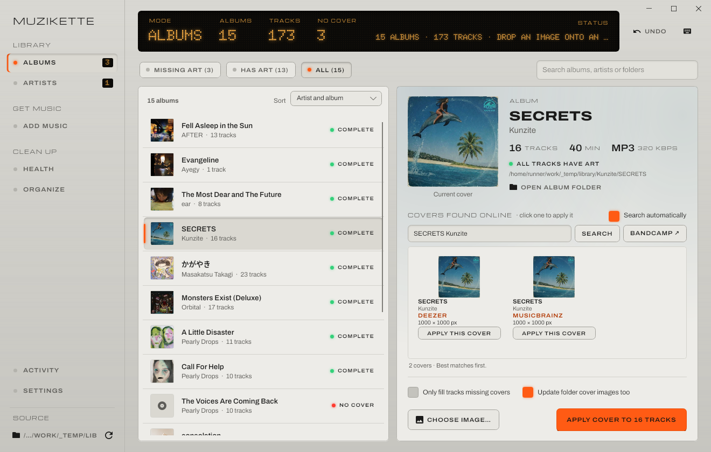
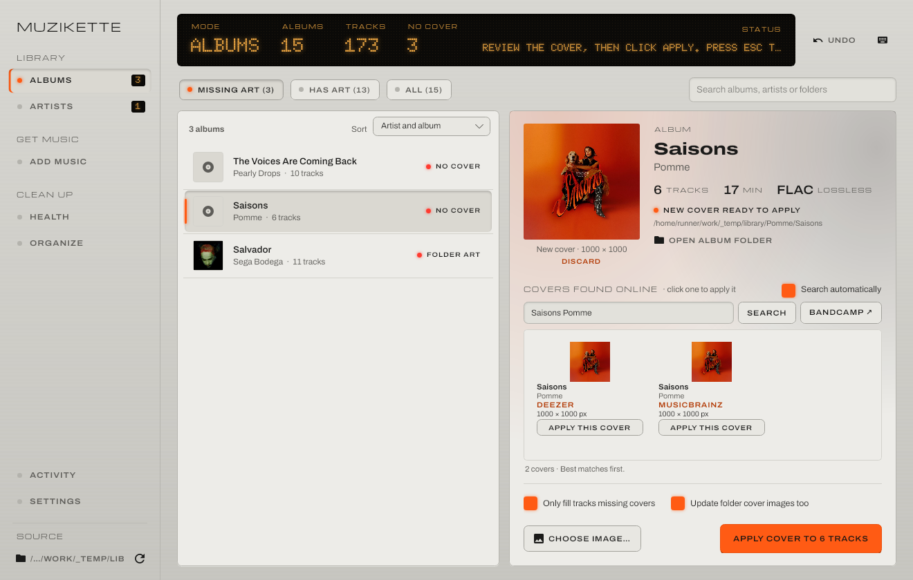
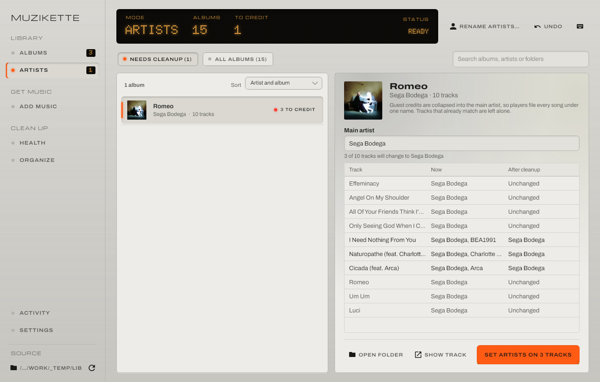
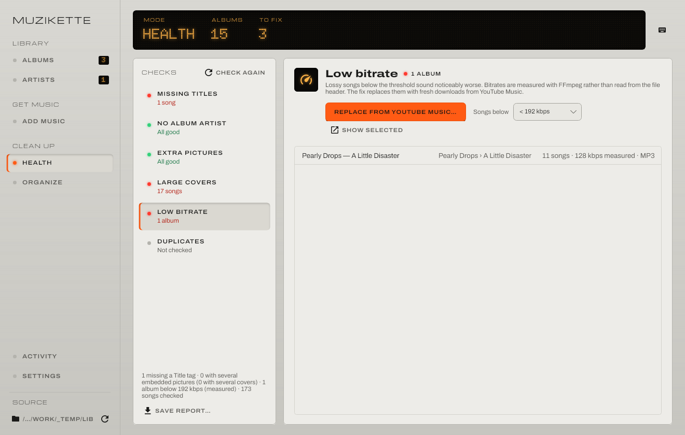
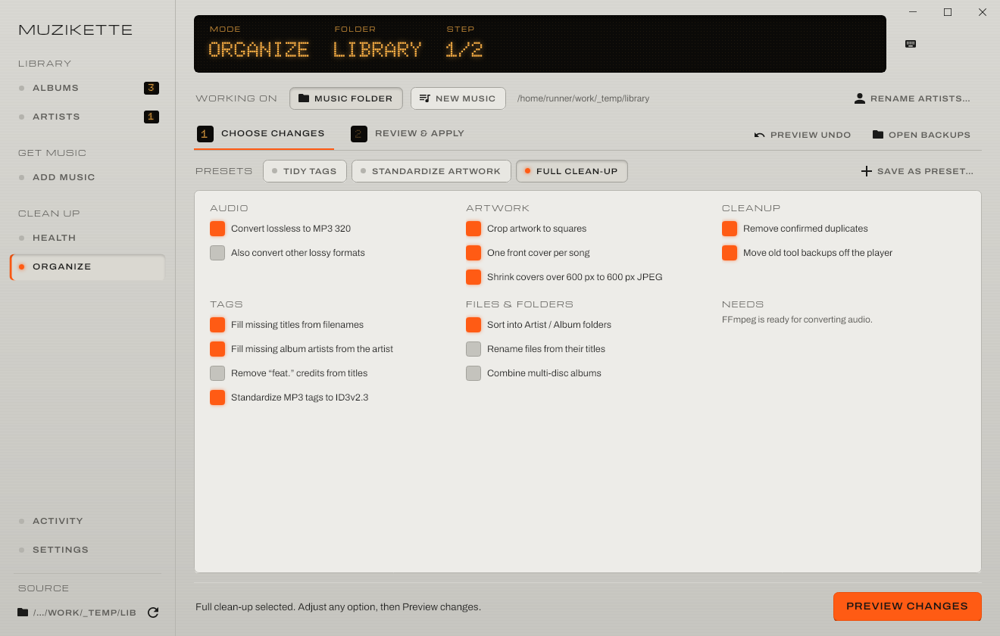
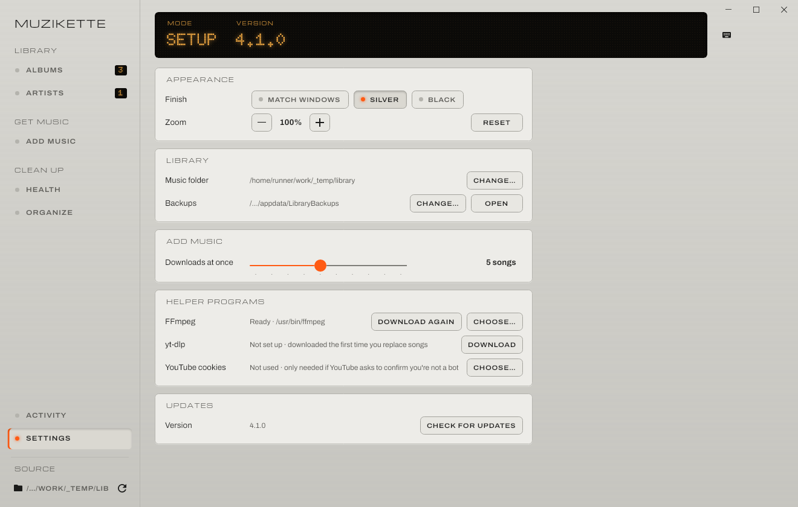

<p align="center"></p>

<h1 align="center">Muzikette</h1>

<p align="center">A Windows app for keeping a music library in order: album covers, artist credits, tags, formats, duplicates and folders.<br>Every change is previewed first, backed up, and can be undone.</p>

<p align="center"><b><a href="https://github.com/ISASTO/Muzikette/releases/latest">Download Muzikette-Setup.exe</a></b> · Windows 10 and 11, 64-bit · free and open source</p>

<picture>
  <source media="(prefers-color-scheme: dark)" srcset="docs/albums-black.png">
  
</picture>

Muzikette looks like a piece of hi-fi equipment: a brushed **Silver** finish, or **Black**, following Windows. The amber display at the top of each page shows where you are and what is running.

Formerly **Music Library Manager** (Album Art Tool). Updating from it keeps your settings, backups and Undo history; see [Updating from Music Library Manager](#updating-from-music-library-manager).

## What it does

| Page | |
|---|---|
| **Albums** | Find albums missing cover art, pick a cover from online suggestions or drop in an image, and apply it. Covers are saved in the background while you move on to the next album. |
| **Artists** | Credit every song of an album to its main artist (collapsing "feat." guests), or rename an artist across the whole library. |
| **Add music** | Search YouTube Music for artists, albums and songs and download them as MP3 320 into a New music folder, ready to tidy and add to your library. |
| **Health** | What needs attention: missing titles and album artists, extra or oversized pictures, low-bitrate albums and duplicate copies, each with a fix. |
| **Organize** | Convert, standardize, tidy and reorganize the whole library with presets. You review every change before it is applied. |
| **Activity** | What is running, what finished, what went wrong, and Undo. |

### Albums

<picture>
  <source media="(prefers-color-scheme: dark)" srcset="docs/new-cover-black.png">
  
</picture>

1. Choose your music folder. Muzikette scans it and every subfolder, and reopens it next time.
2. **Missing art** lists albums where at least one song has no embedded cover; **Has art** and **All** show the rest.
3. Select an album. Its cover search runs automatically (Bandcamp, Deezer and MusicBrainz's Cover Art Archive) and shows each cover's real resolution. Click one to queue it, or drop an image on the album, or **Choose image…**.
4. **Apply** adds the album to the queue. Keep working: covers download and save one album at a time, and the album list shows what is queued and what is being written.

Covers are embedded as 600 px JPEGs (never enlarged or cropped) and replace any other pictures in the song, so each song ends up with exactly one front cover. **Only fill tracks missing covers** leaves songs that already have one alone. **Update folder cover images too** updates `cover.jpg`/`folder.jpg` and the like, or creates `cover.jpg`. Audio is never re-encoded for a cover or artist change.

### Artists

<picture>
  <source media="(prefers-color-scheme: dark)" srcset="docs/artists-black.png">
  
</picture>

Each album's songs are compared with its main artist. The suggestion uses the album artist tag, or a lead artist shared by every song; band names such as *Earth, Wind & Fire* stay whole, and compilations without a lead artist get no automatic suggestion. Compare **Current track artists** with **After cleanup**, edit the name if you like, and apply: only the songs that change are written. **Rename artists…** changes one or more artists to a single name everywhere in the library (Artist and Album Artist tags), with a preview in Organize.

### Health

<picture>
  <source media="(prefers-color-scheme: dark)" srcset="docs/health-black.png">
  
</picture>

Health works from the last scan, so it opens instantly and never changes a file. Each check has a light: red when it found something, green when all is well.

- **Missing titles** and **No album artist**, with fixes that fill them in (titles from the filename, album artists from the album's artist).
- **Extra pictures** (several embedded pictures, so players may show any of them) and **Large covers** (bigger than 600 px, so every song is larger than it needs to be).
- **Low bitrate**: lossy albums below a threshold you choose. Header bitrates can be wrong, so each candidate is measured with FFmpeg. The fix is **Replace from YouTube Music…** (below).
- **Duplicates**: copies of the same song or album, found by comparing the audio rather than names. Nothing is deleted here.

### Organize

<picture>
  <source media="(prefers-color-scheme: dark)" srcset="docs/organize-black.png">
  
</picture>

Pick a preset (**Tidy tags**, **Standardize artwork**, **Full clean-up**) or your own combination, then **Preview**: nothing is touched until you review the list and apply it. You can uncheck any change.

- **Convert lossless to MP3 320** (optionally other lossy formats too). The new MP3 keeps tags and artwork and is decoded completely before the original is replaced.
- **Crop artwork to squares**, **One front cover per song**, **Shrink covers over 600 px**.
- **Fill missing titles from filenames**, **Fill missing album artists**, **Remove "feat." credits from titles**, **Standardize MP3 tags to ID3v2.3**.
- **Sort into Artist / Album folders**, **Rename files from their titles**, **Combine multi-disc albums**.
- **Remove confirmed duplicates** (identical audio on the same album only) and **Move old tool backups off the player**.

Originals go to the backup folder on your PC, and **Preview Undo** (in Organize, or from Activity) restores the last run, even after a restart. Conflicting names never overwrite: both files are kept.

### Add music and Replace songs

Search YouTube Music (music.youtube.com) and add albums or songs. They download as MP3 320 with full tags and cover into **New music**; tidy them up with Organize and click **Add to library** to move them into your music folder (undoable). From **Health › Low bitrate**, **Replace songs** finds each low-bitrate album on YouTube Music, pairs your songs with its tracks by title, number and length, and replaces the ones you check, backing up the originals first.

The first time, Muzikette downloads yt-dlp, Deno and FFmpeg from their official GitHub releases and checks their SHA-256 checksums. YouTube Music's best free stream is about 130–160 kbps Opus; it is saved as MP3 320 for compatibility. Downloading from YouTube is subject to YouTube's terms of service; use it for music you are entitled to.

### Settings

<picture>
  <source media="(prefers-color-scheme: dark)" srcset="docs/settings-black.png">
  
</picture>

Finish (Match Windows, Silver or Black), the music and backup folders, downloads at once, helper programs and **Check for updates**.

## Safety

- Every change is made on a copy, checked, and swapped in only after a verified backup of the original is saved on your PC (outside the music folder, so players don't index it). The default backup folder is `%LOCALAPPDATA%\Muzikette\LibraryBackups`.
- **Undo last change** restores the latest cover or artist edit; Organize's **Preview Undo** restores its last run, including moves, conversions and removals, after a restart too. Undo refuses to overwrite a file changed since.
- Files that changed since the scan, read-only files and locked files are skipped with an explanation in Activity. One failed song never stops the rest.
- No account, no background service. Searches send only the album title and artist; your music never leaves your PC.

## Formats

MP3, FLAC, M4A/M4B, Ogg, Opus, WMA, WAV, AIFF, APE and WavPack. Albums are grouped by folder, album title and album artist, so compilations stay together and separate editions stay separate. Scans run in the background, can be stopped, and are cached: reopening an unchanged library reads no music files (**Shift+F5** reads everything again).

## Keyboard

**Ctrl+1 … Ctrl+6** Albums, Artists, Add music, Health, Organize, Activity · **Ctrl+,** Settings · **Ctrl+F** search · **Ctrl+O** choose a music folder · **F5** rescan · **Ctrl+Enter** apply · **Esc** discard a staged cover · **Ctrl+Z** undo · **F1** all shortcuts.

## Install and update

Run **Muzikette-Setup.exe**. It installs for your Windows account only (no administrator prompt), with a Start menu entry and an uninstaller in **Settings › Apps**. Prefer no installer? **Muzikette-Portable.zip** contains the same app. **Settings › Check for updates** downloads a newer release, verifies its SHA-256 checksum and version, and reopens the app in the same music folder.

### Updating from Music Library Manager

Use **Get updates** in Music Library Manager as usual (3.x and the old 2.x portable EXE both work). Muzikette replaces it: the program moves to a Muzikette folder with new shortcuts, and on first launch your settings, New music folder, backups and Undo history move from `%LOCALAPPDATA%\AlbumArtTool` to `%LOCALAPPDATA%\Muzikette`.

## Build and test

Install the .NET 10 SDK. The core library and the test suite (including headless checks of every page) also run on Linux and macOS.

```powershell
dotnet run --project src/AlbumArtTool                                              # run from source
dotnet publish src/AlbumArtTool/AlbumArtTool.csproj -c Release -r win-x64 -o dist/app   # native (AOT) build
ISCC.exe /DAppVersion=4.0.0 /DSourceDir=dist\app /DOutputDir=dist installer\AlbumArtTool.iss
```

```powershell
dotnet build tests/AlbumArtTool.Tests/AlbumArtTool.Tests.csproj -c Release
$env:ALBUMART_FFMPEG = 'C:\path\to\ffmpeg.exe'
dotnet tests/AlbumArtTool.Tests/bin/Release/net10.0/AlbumArtTool.Tests.dll TestResults   # screenshots land in TestResults
```

The suite covers real round trips in nine audio formats (decoded-audio hashes, preserved tags, byte-exact Undo), scanning, artist cleanup, duplicates, every Organize option with crash recovery, update verification, the data-folder move from Music Library Manager, and the pages themselves. CI also installs the real installer, upgrades a real Music Library Manager 3.12.1 install and a 2.5.2 portable copy, and measures startup. Test audio is synthesized tones; it contains no music.

The README screenshots come from a manual CI run (**Actions › Build, test and package › Run workflow › showcase**) that fetches the covers and track lists of real albums on the build machine and builds a library of silent stand-in files. Nothing it downloads is committed.

Push a `v*` tag, or merge a commit whose message contains `[release]` into `main`, to publish a release. The version comes from `Directory.Build.props`.

## Credits and license

Muzikette is MIT licensed. TagLibSharp is LGPL-2.1-or-later (the native build links it; the full source and build steps above let you relink it with a modified TagLibSharp). Avalonia and SkiaSharp are MIT. The Archivo, Michroma and Doto fonts are under the SIL Open Font License. FFmpeg, yt-dlp and Deno are optional separate programs with their own licenses. See `THIRD-PARTY-NOTICES.txt` and `licenses/`.

Album covers in the screenshots belong to their artists and labels and are shown only to illustrate the app.
